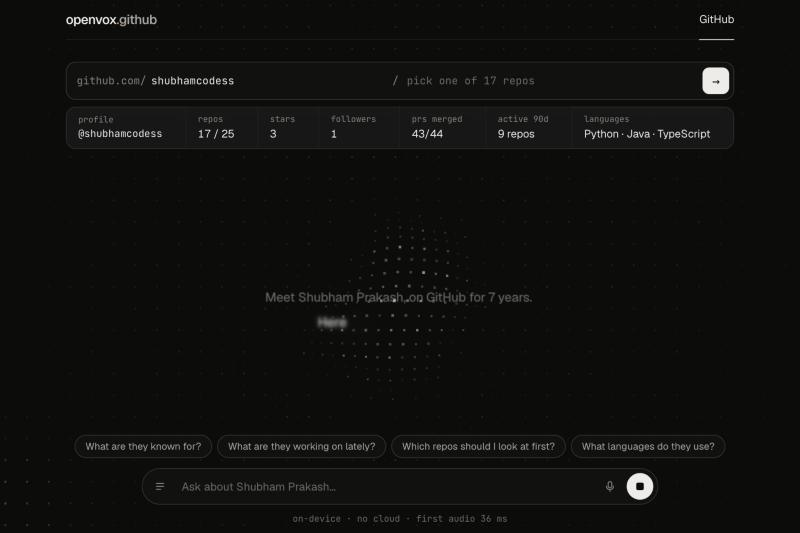
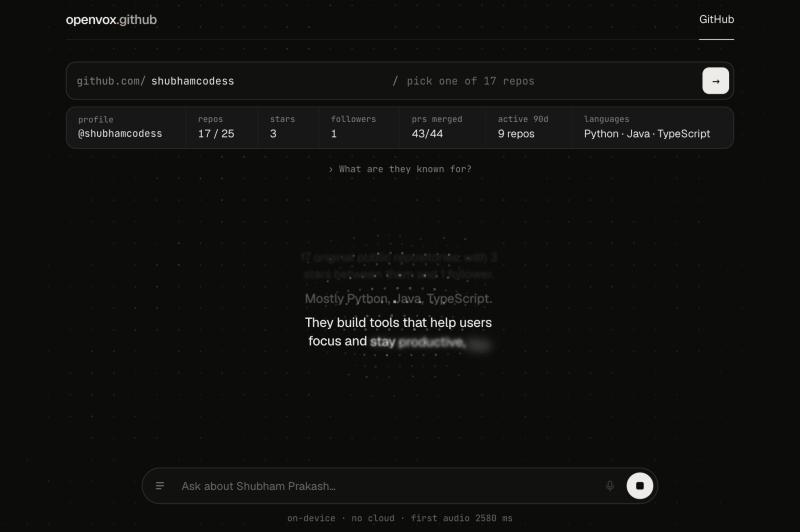
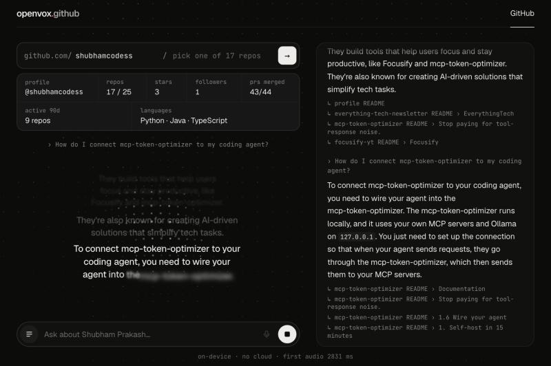
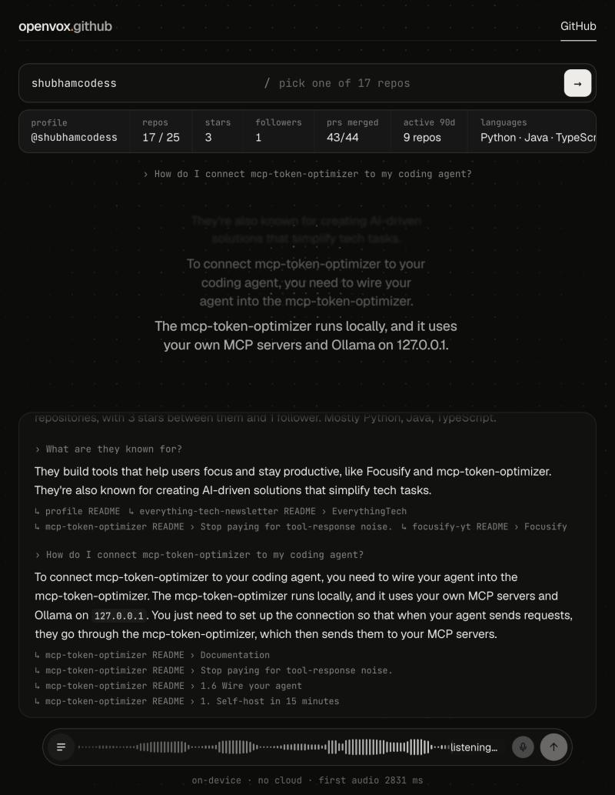

# openvox

**Talk to GitHub.** Type a username or `owner/repo`, and openvox reads the public data, introduces it out loud, then answers your spoken questions in a natural voice. Everything runs in your browser: no backend, no API keys, no audio leaves your machine.

**Live demo:** https://shubhamcodess.github.io/openvox/ (needs a WebGPU browser such as current Chrome or Edge)



openvox is the first mode of a larger voice-first app. `GitHub` is the only mode today; the header is built for more.

## What it does

- **Introduces a profile or repo** in a streamed voice, using only numbers computed in code (stars, PRs merged, activity), never invented by a model.
- **Answers questions by voice or text**, grounded in the profile facts and the READMEs of the repos. If GitHub can't show something (comments, salary, work history), it says so plainly instead of guessing.
- **Lets you interrupt.** Start talking and it stops; it waits through thinking pauses instead of cutting you off.
- **Shows its sources.** Each answer lists the README sections it drew from.

| Answer, spoken as lyrics | Transcript with sources |
|---|---|
|  |  |



## How it works

```
mic ─► VAD (Silero) ─► polish audio ─► STT (Moonshine) ─► clean transcript ─┐
                                                                            ▼
GitHub REST + raw READMEs ─► facts sheet + BM25 index ─► route ─► LLM (WebGPU) ─► sentences ─► TTS (Phonon) ─► speaker
```

| Stage | Choice | Notes |
|---|---|---|
| Voice | [Phonon 31M](https://huggingface.co/gradium/phonon-31m-en) via `phonon-tts` | Streams sentence by sentence; first audio in well under a second once loaded |
| Language model | Qwen3-1.7B via WebLLM (WebGPU), in a worker | Picked by a hallucination eval, below |
| Speech to text | Moonshine-base via transformers.js, in a worker | Runs on WASM so it doesn't fight the LLM for the GPU |
| Voice activity | Silero VAD v5 | 400 ms pre-roll; sends after a grace period that adapts to whether the sentence sounds finished |
| Retrieval | BM25 over heading-aware chunks | Synonym expansion, boost for a repo named in the question, relevance floor, follow-up carry-over |
| UI | React, TypeScript, Vite | Dot-field visual and lyric-style captions that react to the voice |

**Details that matter**

- **Grounded by construction.** Numbers come from code. Superlatives ("most starred") are precomputed, because small models misread them from lists.
- **Question routing.** Employer and location answer straight from the profile. Things GitHub can't show get a direct "can't see that" plus what can be covered. Person-level questions use the facts sheet only; content questions retrieve from READMEs.
- **Built for ears, not eyes.** Prompts ask for short spoken sentences. A normalizer then turns links into "this link", commands into "the command shown on screen", and spells or pronounces acronyms before they reach the voice.
- **Small-model hygiene.** Refusals are kept out of chat history, and prompts use rules rather than example sentences, because a 1.7B model copies both.
- **Audio polish.** High-pass filter, edge trimming, level normalization and fades before transcription; fillers, stutters and phantom "thank you" transcripts are removed after.

## Honest numbers

`/?eval` runs 10 questions on a fictional profile: 6 fact lookups and 4 traps where the right answer is "I don't have that" (single runs, treat ±1 as noise).

| model | pass | facts | traps | first token | tok/s |
|---|---|---|---|---|---|
| **Qwen3-1.7B** (default) | 9/10 | 6/6 | 3/4 | ~400 ms | ~60 |
| Llama-3.2-1B | 8/10 | 5/6 | 3/4 | ~260 ms | ~99 |
| SmolLM2-1.7B | 7-8/10 | 3-5/6 | 4/4 | ~420 ms | ~85 |
| Qwen2.5-1.5B | 7/10 | 4/6 | 3/4 | ~650 ms | ~32 |

Measured on an Apple M-series laptop. The one trap Qwen3 misses (lifetime commits) is caught by the routing layer in the app.

## Privacy and limits

- No server of mine, no telemetry. Audio never leaves the browser.
- Model weights (about 1 GB for the LLM, roughly 100 MB for speech recognition, 65 MB for the voice) download once from Hugging Face and the MLC CDN, then are cached.
- GitHub data uses the public API **anonymously**: 60 requests per hour per IP, about 12 per repo. A notice appears if you hit it.
- Public data only: no private repos, comments, reviews or work history.
- Needs WebGPU for the LLM. A 1.7B model is small: it can be vague on long procedures, which is why the exact commands stay on screen.

## Run it

```bash
npm install
npm run dev      # http://localhost:5173
npm test         # retrieval, routing, speech normalizer, audio polish
npm run build
```

Deep links: `?u=username` and `?r=owner/repo`. Edit pronunciations in the `PRONOUNCE` table in `src/speakable.ts`.

## Deploy

`.github/workflows/deploy.yml` tests, builds and publishes to GitHub Pages on every push to `main`. In the repo settings, set **Pages → Source** to **GitHub Actions** once. Paths are relative, so it works under any repo name.

## Roadmap

More modes beyond GitHub, narration personas, a voice picker, an embeddings A/B for retrieval.
